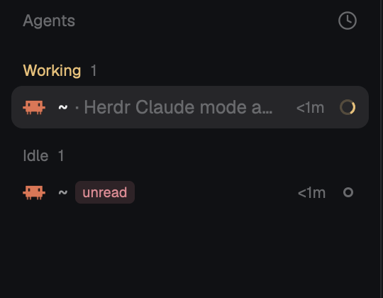

# Agents with unread marks

The Agents sidebar of the Herdr desktop app, with one addition: any agent you
want to come back to carries a small red `unread` badge after its name, and the
badge goes away by itself when you focus that agent. Everything else in the
list (sections, sorting, pins, sub-agents, the narrow rail) is Herdr's own.

## What you see

- The shipped Agents list, 268 px wide in the left sidebar under Spaces: a
  header row, then `Needs you`, `Done`, `Working` and `Idle` sections (or
  spaces, when grouped), each agent a 30 px row with its program icon, name,
  age and status glyph.
- A marked agent has a pill after its name: the word `unread` in 10 px
  semibold text, colour `theme().ansi1` (the theme's red) on the same red at
  15% opacity, 16 px tall, 4 px radius, 5 px side padding.
- Hovering an unmarked row shows a square outline icon (13 px, dim, red on
  hover) to the left of the pin icon. Hovering a marked row shows only the pin.
- In the narrow rail (sidebar under 160 px) the agent's number is drawn in
  `ansi1` instead of muted when it is marked.

## How it behaves

- A mark is the label `herdr.mark=unread` on the agent's core terminal, set
  and removed with `hc label <address> herdr.mark=unread` and
  `hc label <address> herdr.mark=`. The mod reads it from `terminals()`, so
  marks survive app restarts, show in every Herdr client, and end with the
  terminal.
- `agents-marks.toggle` (a key action, bound to `cmd-shift-m` in `keys.json`)
  marks or unmarks the focused terminal. If the focused terminal is not a
  listed agent, a 3 s warning toast says "No agent to mark".
- Clicking the square icon marks that row. Clicking the `unread` pill clears
  it. Both stop the click from focusing the row.
- When the focused agent changes to one that is marked, the mark is cleared.
  Marking the agent currently in view keeps the mark until you leave and
  return. The focus at the moment the mod loads counts as already seen, so a
  reload never clears anything.
- Agent statuses (working spinner, blocked badge, done dot, idle ring) are
  unchanged; a mark never changes sorting or sections.
- Label writes are deduplicated per address while one is in flight; a failed
  `hc` call shows an error toast with its stderr.

## Built from

- `mods/agents-marks/main.js`: Herdr's shipped `agents` mod (version 0.1.13,
  cloned with `mod.clone`), plus:
  - `MARK_LABEL = "herdr.mark"`, `MARK = "unread"`, and `marksOf(terminals())`,
    a map of live terminal addresses carrying the label.
  - In `init`: a `nextCommand()` loop answering `toggle`, and the fields
    `prevFocused` and `markWrites`.
  - Methods `setMark(address, on)` (runs `hc(["label", address, ...])`),
    `toggleMark(address)` and `clearOnFocus(list, marks)` (called from
    `render` after `migratePins`).
  - In the row builder: `isMarked`, the `badge` element and the `mark` hover
    button, inserted next to the existing pin button.
- `mods/agents-marks/mod.json`: `{ "place": "none", "title": "Agents (marks)" }`.
- `keys.json`: `"layout:herdr-marks": { "cmd-shift-m": "agents-marks.toggle" }`.
- `herdr` functions used beyond the shipped mod's: `hc`, `nextCommand`,
  `notify`, `focused().terminal`.
- A cloned layout: `layout.clone {"name":"main","as":"herdr-marks"}`, then the
  agents block's `content.mod` changed from `agents` to `agents-marks`.

## Install

1. Copy `mods/agents-marks/` into `~/.config/herdr-app/mods/`.
2. `herdr-app do layout.clone '{"name":"main","as":"herdr-marks"}'` (or clone
   the layout the person uses).
3. In `~/.config/herdr-app/layouts/herdr-marks.json`, change `"mod": "agents"`
   to `"mod": "agents-marks"`.
4. Merge `keys.json` into `~/.config/herdr-app/keys.json`. Ask before
   replacing a key the person already uses.
5. `herdr-app check ~/.config/herdr-app/mods/agents-marks`, then
   `herdr-app status` must list no errors and `"layout": "herdr-marks"`.

Tell the person before installing: the mod runs `hc` (to write labels) and
reads nothing outside Herdr's own data.

## Watch out

- Shipped layouts and mods are read-only; editing `mods/agents/` directly is
  moved aside on the next start. The clone and the layout clone are required.
- The key must be under `layout:herdr-marks` (or `global`): `<mod>.<command>`
  actions reach shown copies only, and the mod is shown only in that layout.
- `marksOf` filters on `state === "live"`; a lost terminal's label is ignored
  until core gives it a shell again.
- Only agents (terminals reporting a status) are listed, so a mark on a plain
  shell is stored but never drawn.
- `herdr-app shot` returns the last drawn frame; when the window is not
  redrawing (the person is away), repeated shots are byte-identical and prove
  nothing.
- Remote agents use `machine/t7` addresses; `hc label machine/t7 ...` accepts
  them unchanged.
- The clone does not follow Herdr's later changes to the `agents` mod.

## Done when

- `herdr-app check ~/.config/herdr-app/mods/agents-marks` passes and
  `herdr-app status` shows no errors with the `herdr-marks` layout.
- `hc label <idle agent> herdr.mark=unread` makes a red `unread` pill appear on
  that row within a second; `hc label <it> herdr.mark=` removes it.
- With another agent focused, `cmd-shift-m` adds the pill to the focused
  agent; pressing again removes it.
- Focusing a marked agent (click, `cmd-]`) removes its pill and
  `hc get <it> --json` no longer lists `herdr.mark`.
- Marking the focused agent keeps its pill until you focus another agent and
  come back.
